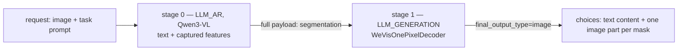

# WeVisOne-VL in vllm-omni

Goal: serve Tencent WeChat Vision `WeVisOne-VL` (Qwen3-VL-4B + a 9.6 M-parameter pixel decoder) in
vllm-omni as a two-stage pipeline, return masks/alpha mattes over `/v1/chat/completions`, cover all
eleven reference tasks, and keep everything for this model in `customs/` (code, examples, README) plus
this decision record. Nothing is added to `docs/`, `recipes/`, or `mkdocs.yml`.

Reference code and checkpoint live in `extra_repos/WeVisOne-VL` and `extra_repos/WeVisOne-VL-4B`
(git-ignored). vllm-omni code must never import `wevisone_vl`; only `customs/wevisone/ref_golden.py`
may, because it is the parity oracle.

## Status

| Phase | What | State |
|---|---|---|
| A | Reference grounding: `customs/wevisone/ref_golden.py`, golden fixture `customs/wevisone/golden/matting/` | done |
| B | Ported modules: `constants.py`, `config.py`, `decoder.py`, `msda.py`, `feature_bridge.py`, `wevisone_vl.py`, `processing.py` | done |
| C | Payload schema (`Segmentation` TypedDict + `SegmentationStruct` + `_NESTED_KEYS`) and bridge `stage_input_processors/wevisone.py` | done |
| D | `pipeline.py`, both registries, `deploy/wevisone_vl.yaml`, `deploy/wevisone_vl_text_only.yaml` | done |
| E | `model_extras/wevisone.py`, `_EXTRA_SPECS`, family rule, `_create_image_choice` stacked-mask extension | done |
| F | Examples: `customs/wevisone/` (README, client, `samples.json`, generator, visualize, serve/run scripts) | done |
| G | Tests: parsers, feature bridge, decoder mask post-processing, stage bridge, payload schema, output modality, serving choice, pipeline/registry, golden parity | done (CPU) |
| — | L2 online-serving e2e, L4 expansion, Buildkite job wiring, GPU runtime parity | **not done** (no vllm runtime on this host) |

All new files are `py_compile`-clean, SPDX-header-clean, and within the 120-column limit;
`tools/pre_commit/check_test_marks.py` and `check_spdx_header.py` pass repo-wide. CPU unit tests that
do not import `vllm` run on this host (33 passed); everything that imports `vllm` could only be
verified by hand with stubbed modules, so the pytest run must happen in docker.

## Architecture



Stage 0 captures the pre-merger ViT block outputs (layers 5/11/17/23) and the last LM decoder-layer
output at `<OBJ>` positions before the final norm, parses boxes from the *generated* token ids, and
hands everything to stage 1 as the `segmentation` payload group. Stage 1 decodes
`[N, 1, H, W]` float32 masks in `[0, 1]`, one row per box, in box order.

## Decisions

1. **Two-stage pipeline.** Stage 0 is the AR VLM (`engine_output_type="text+segmentation"`), stage 1 is
   the pixel decoder (`LLM_GENERATION`, `input_sources=(0,)`, `requires_full_payload_input=True`,
   `final_output=True`, `final_output_type="image"`). `async_chunk` must stay `false` because
   full-payload accumulation is disabled when chunking is on.
2. **Hook parity is the gate.** Capture points reproduce the reference exactly: pre-merger block
   outputs at 5/11/17/23 (block 23 via `visual.merger`, since `deepstack_visual_indexes=[5,11,17]`)
   and the last LM decoder-layer output **before** the final norm (residual add is deferred to the next
   RMSNorm in vLLM, so it must be reconstructed). `enforce_eager` is required on stage 0 — module hooks
   do not fire under `torch.compile`. Validate one image against the reference before trusting any
   tolerance; recorded deltas live in [Findings](Findings.md).
3. **Decoder is optional.** The sidecar `mask_decoder.pt` is loaded lazily on the first request that
   actually needs a mask. Text-only tasks (detection, count, ocr, freeform) run without it; the stage
   bridge returns `None` and the decoder returns an empty tensor for those requests, so no
   `mask_decoder.pt` is required to serve text-only. A clear `FileNotFoundError` is raised only when a
   mask is requested and the sidecar is missing. `--pipeline wevisone_vl_text_only` is the single-stage
   text-only variant.
4. **Decoder canvas comes from the original photo.** `decoder_image = image.convert("RGB").resize(
   (cnn_image_size, cnn_image_size), resample=BICUBIC)`, then float32 / 255 → plain float RGB in `[0, 1]`.
   **No mean/std normalization** — the 0.5 mean/std belongs to the Qwen vision processor only, and Qwen
   smart-resize is never used for the canvas. The canvas is carried as extra `batched("image",
   keep_on_cpu=True)` fields (`wevisone_canvas`, `wevisone_hw`) by the custom mm processor.
5. **Response contract.** Boxes stay in the text choice content (the raw `<box>`/`<OBJ>` spans, as the
   reference returns them) because `metrics` carries model metadata only on the diffusion serving path —
   `WEVISONE_EXTRA_OUTPUT_PARAMS = frozenset()`. Masks are delivered as **one stacked `[N, 1, H, W]`
   tensor per request** under `image`; each image part carries `mask_index`, and mask `i` pairs with box
   `i` (positional pairing, box order == mask order). Dict-valued payload keys are rejected by
   `split_mapping_outputs`, which is why masks are one stacked tensor rather than a dict.
6. **`segmentation` is a non-drainable modality.** It is an internal stage-to-stage contract and is
   never drained to a client; `NON_DRAINABLE_MODALITIES` keeps its keys alive for the decoder stage, and
   the client receives the decoded masks under `IMAGE`. `segmentation.t_seg` accumulates by `CONCAT_DIM0`
   across decode steps, so it is deliberately excluded from `_FULL_PAYLOAD_REPLACE_KEYS`.

## Findings (WeVisOne-VL)

- Checkpoint reports `architectures=["Qwen3VLForConditionalGeneration"]` and `model_type="qwen3_vl"`
  with no `auto_map`, so the pipeline key must be resolved from the checkpoint name
  (`tencent/WeVisOne-VL-4B` → `wevisone_vl`), not from the HF config — the family rule in
  `model_extras/registry.py` documents this. No HF export is needed.
- Token ids: `<OBJ>`=152678 (added token, `special: false`), `<box>`=152672, `</box>`=152673,
  coordinate tokens `<0>`..`<1000>` contiguous from 151669, eos `<|im_end|>`=151645, vocab 152680,
  `image_token`=151655. `coord_token_id_base(seg_id) = seg_id - 1009`.
- Box parsing parity is confirmed numerically against the golden fixture: text and id parsers both
  produce `[[0.009, 0.065, 0.753, 1.0]]`. A box is recorded only when its body is followed by `<OBJ>`,
  and `</box>` clears the in-box state — so a box closed before any `<OBJ>` is not a query row. Only
  *generated* tokens may be scanned, never prompt tokens.
- Sidecar `mask_decoder.pt` has four keys: `state_dict` (296 entries, 9,609,764 elements, no prefix),
  `cfg` (`architectures_version "wevisone_vl_v1"`, `vision_feature_layers` as a **list** `[5,11,17,23]`,
  hidden 192, mask feature 64, 32 Fourier freqs, MSDA 3/4/4, transformer 6/8/768, GN 32, stem 128,
  alpha cascade 48 × 2, `cnn_image_size` 1024), `seg_token_id` 152678, `spatial_merge_size` 2.
  `Qwen3VLSegConfig.from_dict` normalizes the list to a tuple so the strict-load path does not log a
  spurious "cfg differs from defaults, rebuilding".
- Patch tokens are **block-major**: the shuffle inverse is
  `reshape(h//m, m, w//m, m, c).permute(0,2,1,3,4)`, not row-major `reshape(h//m, w//m, m, m, c)`.
  `premerge_tokens_to_2d(tokens, grid_hw, spatial_merge_size)` checks merge-size divisibility **before**
  the shape check.
- Mask post-processing (`_masks_from_logits`) is reproduced verbatim: `[N,1,H,W]` or 2-D rows, sigmoid,
  bilinear to the mask size, `[num_masks,1,H,W]` float32 in `[0,1]`. Constant-zero logits give all 0.5,
  which is the deterministic assertion used by the unit tests. Interpolating a tensor to its own size is
  an identity, so the golden mask is reproduced through the inverse sigmoid to ~6e-8 (measured max error
  5.96e-8).
- Golden matting fixture: image 1400×933, box `[[0.009, 0.065, 0.753, 1.0]]`, response
  `<ref>the person</ref><box><9><65><753><1000><OBJ></box>`, mask shape `(933, 1400)` float32,
  seed 1234. Tolerances agreed: boxes 0.001, mean mask 0.02.
- Reproducibility measured over four oracle runs (the committed fixture plus three fresh): response and
  boxes are identical every run, mask tensors are **not** bit-identical — max diff 3.5e-4 against the
  fixture and 5.1e-4 between fresh runs. GPU kernels are not bit-reproducible, so parity checks compare
  masks with tolerances only. Parity tests read the stored fixture and stay self-consistent, so they do
  not depend on regenerating it.
- Serving side: `_create_image_choice` stacks masks, skips zero-numel slices, converts CHW→HWC, scales
  `[0,1]` floats to uint8 by truncation (0.2 → 51, 0.5 → 127), and sets `mask_index` only for stacked
  multi-mask responses (ordinals recorded after the skip, so gaps in an empty stack are preserved).
- Stage 0 cannot see `input_ids` inside `forward` for raw-input-only models, so `<OBJ>` row selection
  happens in the stage input processor via `request.all_token_ids`, and boxes are reconstructed from
  generated token ids there.
- `get_accumulation_strategy` lives in `vllm_omni/outputs/output_modality.py`, `drain_delta_payload` in
  `multimodal_accumulation.py`.
- `batched("image")` processor fields arrive per request as `(1, N)` rows. Unpacking a `(1, 2)` h/w tensor
  directly raised `TypeError` (found by the CPU test); `_hw_pair` now normalizes both `(2,)` and `(1, 2)`
  for `grid_hw` and `mask_hw`.
- Offline CPU run on this host (no `vllm` installed, packages stubbed): 47 passed — parsers 24, feature
  bridge 9, pixel-decoder masks 10, golden parity 4.
- Runtime parity has not been executed on this host: the docker image is unavailable (Docker Hub 401)
  and the host interpreter has no `vllm`, so hook-parity deltas and mask PSNR against the reference are
  still unmeasured. Record them in Findings when the docker run happens.

## Risks

- Hook parity is unmeasured on GPU. If the captured features differ from the reference, every tolerance
  in the parity test has to be re-derived; the CPU tests only prove the shape/contract logic.
- Stage 1 needs an fp32 forward at `cnn_image_size=1024`; the alpha cascade is the memory hotspot
  (`PYTORCH_CUDA_ALLOC_CONF=expandable_segments:True` is set in the deploy yaml for this reason).
- Box/mask positional pairing assumes the VLM emits boxes in the same order the decoder receives query
  rows; the stage bridge drops the request's masks (with a warning) rather than guess a pairing when the
  counts disagree.
- Text-only requests still reach stage 1, which must return a tensor for every request; a change to the
  drain logic that drops empty outputs would break the response contract.

## Verification

1. CPU unit tests (see Testing & CI).
2. Hook parity gate — one image, captured pre-merger features and `<OBJ>` hidden states vs the reference
   hooks; record deltas here, then set tolerances from them.
3. Golden parity: `bash customs/wevisone/run_golden.sh` — text exact, boxes within 0.001, mean mask diff
   within 0.02.
4. Manual API check: `bash customs/wevisone/serve.sh` + `customs/wevisone/openai_request_example.py` with
   `task=matting`; assert the text choice content, grayscale image parts at input size, and that
   `mask_index` pairs with box index.
5. Negative paths: unknown task, `<OBJ>` with no parsed box, missing `mask_decoder.pt` — covered by the
   parser/decoder unit tests; the dfx invalid-param suite is not yet extended.
6. `--pipeline wevisone_vl_text_only` must serve detection/count/ocr without `mask_decoder.pt`.

## Testing & CI

| Level | File | Markers | Runs in CI |
|---|---|---|---|
| L1 | `tests/model_executor/models/wevisone/test_wevisone_parsers.py` | `core_model and cpu` | yes — `pytest -sv tests/model_executor -m 'core_model and cpu'` |
| L1 | `tests/model_executor/models/wevisone/test_wevisone_feature_bridge.py` | `core_model and cpu` | yes, same step |
| L1 | `tests/model_executor/models/wevisone/test_wevisone_pixel_decoder_masks.py` | `core_model and cpu` | yes, same step |
| L1 | `tests/model_executor/models/wevisone/test_configuration_and_pipeline.py` | `core_model and cpu` | yes, same step |
| L1 | `tests/model_executor/stage_input_processors/test_wevisone.py` | `core_model and cpu` | yes, same step |
| L1 | `tests/engine/test_data_entry_keys.py` (segmentation cases) | `core_model and cpu` | yes — engine step |
| L1 | `tests/engine/test_output_modality.py` (segmentation cases) | `core_model and cpu` | yes — engine step |
| L1 | `tests/entrypoints/openai_api/test_serving_chat_mask_choices.py` | `core_model and cpu` | yes — entrypoints step |
| L1 | `tests/model_extras/test_model_extras.py` (WeVisOne cases) | `core_model and cpu` | yes — "Other Test" step |
| local | `tests/model_executor/models/wevisone/test_wevisone_golden_parity.py` | `local_model and cpu` | no — `extra_repos/` is git-ignored, skipped without the fixture |

Local commands (docker, `. /workspace/.venv/bin/activate`):

```bash
# L1 unit tests (CPU)
pytest -sv tests/model_executor/models/wevisone -m 'core_model and cpu'
pytest -sv tests/model_executor/stage_input_processors/test_wevisone.py -m 'core_model and cpu'
pytest -sv tests/engine/test_data_entry_keys.py tests/engine/test_output_modality.py -m 'core_model and cpu'
pytest -sv tests/entrypoints/openai_api/test_serving_chat_mask_choices.py -m 'core_model and cpu'
pytest -sv tests/model_extras/test_model_extras.py -m 'core_model and cpu'

# Golden parity (needs the reference checkpoint + fixture; add -m 'local_model and cpu')
WEVISONE_MODEL_DIR=extra_repos/WeVisOne-VL-4B WEVISONE_GOLDEN_DIR=customs/wevisone/golden \
  pytest -sv tests/model_executor/models/wevisone/test_wevisone_golden_parity.py \
  -m 'local_model and cpu' --run-level 'local_model'
```

CI-like selection (the four L1 steps in `.buildkite/cuda/test-ready.yml`, verbatim):

```bash
pytest -sv tests/model_executor -m 'core_model and cpu'
pytest -sv tests/diffusion/models -m 'core_model and cpu'
pytest -sv tests/entrypoints tests/engine tests/diffusion --ignore=tests/diffusion/models -m 'core_model and cpu'
pytest -sv tests/ -m 'core_model and cpu' \
  --ignore=tests/diffusion --ignore=tests/model_executor --ignore=tests/entrypoints --ignore=tests/engine
```

Prerequisites for the L1 steps: `vllm` + `vllm_omni` importable, `msgspec` (for
`tests/engine/test_data_entry_keys.py`), `torch`, `numpy`, `pillow`, `pytest`, and
`tools/pre_commit/check_test_marks.py` passing for the new files (CI-level `core_model` plus the `cpu`
platform mark). No GPU is required; the tests never request `omni_runner`/`online_client`.

Buildkite wiring is not yet added: `omni_wevisone_vl_function` in
`.buildkite/common/ci_source_file_dependencies.yml` and the L2/L4 steps are still open, so the new files
are collected by the generic L1 steps only.

## Sample generation

`customs/wevisone/samples.json` is the checked-in spec — one entry per task shape (all eleven). The
client builds the instruction with `build_prompt`, submits one `image_url` part per mask with
`mask_index`, and writes the response text plus the decoded masks.

```bash
bash customs/wevisone/serve.sh                                  # two-stage server on port 8091
python customs/wevisone/openai_request_example.py --task matting --query "the person"
python customs/wevisone/generate_samples.py                     # every entry
python customs/wevisone/generate_samples.py --only detection ocr
python customs/wevisone/visualize.py --out /tmp/wevis-out       # overlay masks on the source image
bash customs/wevisone/run_samples.sh                            # same, inside docker
bash customs/wevisone/run_golden.sh                             # reference oracle -> golden fixture
```

Episode record: [E11 — WeVisOne-VL](episodes/E11-wevisone-vl.md).
